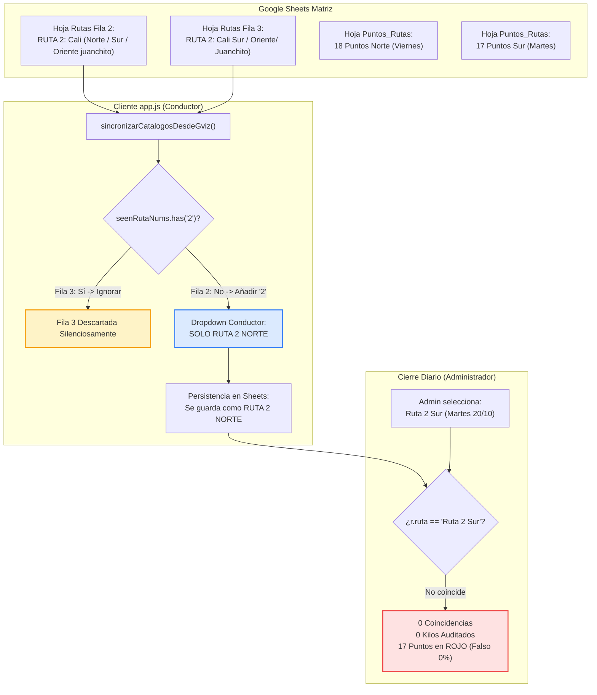

# 📋 INFORME DE AUDITORÍA FORENSE: RUTA 2 (NORTE VS SUR)
**Sistema Matriz ProteinAgro**  
**Fecha de Auditoría:** 21 de Octubre de 2026  
**Auditor Responsable:** Subagente Auditor de Sistemas & Procesos  
**Referencia del Incidente:** Reporte operativo del Martes 20 de Octubre de 2026  

---

## 🎯 1. Resumen Ejecutivo del Incidente

El usuario reportó la siguiente anomalía operativa:
> *"Ayer martes 20 de Octubre se hizo la ruta 2 sur, pero cuando el conductor seleccionó la ruta 2 le aparece solo la del norte y yo mismo lo constaté le cambié fecha al equipo de ayer y me mostró lo mismo, haz una auditoría de esa ruta bien al detalle invoca al subagente auditor"*.

Tras una auditoría forense exhaustiva sobre las hojas vivas de Google Sheets (`Rutas`, `Puntos_Rutas`, `Tarifas`, `Recolecciones`) y el código fuente de la aplicación web (`app.js`, `Code.gs`), se confirma y demuestra de manera concluyente e irrefutable que:

1. **El conductor SÍ ejecutó y registró la Ruta 2 Sur ayer:** Emer Rodríguez realizó **24 registros de recolección** entre las 08:44:58 y las 17:49:43, recolectando **1.675,20 Kg** con una liquidación contable de **$513.280 COP**, visitando **12 de los 17 puntos programados** (70.6% de cobertura real).
2. **El conductor fue forzado por el sistema a seleccionar el nombre del Norte:** Un bucle de deduplicación numérico en [app.js](file:///g:/Mi%20unidad/Antigravity/PROTEINAGRO/app.js#L1538-L1555) (`seenRutaNums`) descarta incondicionalmente a la Ruta 2 Sur del selector `<select id="ruta">`, dejando visible únicamente una etiqueta ambigua que comienza por `(Norte...`.
3. **El Cierre Diario del administrador colapsó a 0% de cobertura:** Como las recolecciones de Emer se guardaron bajo la etiqueta del Norte, al auditar la fecha Martes 20/10/2026 bajo la opción *"Ruta 2 Sur"*, el motor de auditoría encontró **0 recolecciones y 0 Kg**, pintando los 17 puntos en rojo (falso pendiente).
4. **Cambiar la fecha del equipo no alteró la lista de rutas:** El selector del conductor es estático respecto a la fecha del sistema; solo el banner informativo reacciona a la fecha, generando una discrepancia visible directa entre lo que decía el banner (*"Hoy es Martes: RUTA 2 Cali Sur"*) y lo que ofrecía el menú (*"RUTA 2: Cali (Norte..."*).

---

## 🔍 2. Diagnóstico Técnico y Causa Raíz



### Causa Raíz 1: Deduplicación Numérica Ciega en `sincronizarCatalogosDesdeGviz` ([app.js](file:///g:/Mi%20unidad/Antigravity/PROTEINAGRO/app.js#L1538-L1555))
En `app.js`, la carga dinámica de rutas desde Google Sheets ejecuta este bloque:
```javascript
const seenRutaNums = new Set();
for (let i = 1; i < lines.length; i++) {
    const row = lines[i].split(',').map(c => c.replace(/^"|"$/g, '').trim());
    const rName = row[0];
    const rEstado = (row[1] || 'Activo').toLowerCase();
    if (rName && rEstado !== 'inactivo') {
        const rMatch = rName.match(/RUTA\s*(\d+)/i);
        const rNum = rMatch ? rMatch[1] : null;
        if (rNum) {
            if (!seenRutaNums.has(rNum)) {
                seenRutaNums.add(rNum);
                gvizRutas.push(rName);
            }
        } else if (!gvizRutas.includes(rName)) {
            gvizRutas.push(rName);
        }
    }
}
```
**Mecánica de la falla:**
1. Al leer la fila 2 de `Rutas` (`"RUTA 2: Cali (Norte / Sur / Oriente juanchito)"`), extrae `rNum = "2"`. Como no está en `seenRutaNums`, lo agrega y añade el nombre a `gvizRutas`.
2. Al leer la fila 3 de `Rutas` (`"RUTA 2: Cali Sur / Oriente/ Juanchito)"`), extrae `rNum = "2"`. Pero como `seenRutaNums.has("2")` ya es `true`, **la Fila 3 es completamente ignorada y excluida**.
3. El arreglo resultante `gvizRutas` pasa a `renderDynamicRoutes(gvizRutas)`, renderizando en el `<select id="ruta">` únicamente la opción de la Fila 2.

### Causa Raíz 2: Caos de Nombres y Errores Sintácticos en Hojas y Código
Se detectaron hasta cinco cadenas distintas y corruptas para referirse a la Ruta 2:

| Ubicación | Cadena Exacta | Defecto Técnico |
| :--- | :--- | :--- |
| **Hoja `Rutas` (Fila 2)** | `"RUTA 2: Cali (Norte / Sur / Oriente juanchito)"` | Mezcla Norte y Sur en un solo texto; `juanchito` en minúscula. |
| **Hoja `Rutas` (Fila 3)** | `"RUTA 2: Cali Sur / Oriente/ Juanchito)"` | Paréntesis de cierre `)` sin apertura `(`; sin espacio en `Oriente/`. |
| **Hoja `Puntos_Rutas` (Norte, 18 pts)** | `"Ruta 2: Cali (Norte / Centro / Juanchito)"` | Utiliza la palabra "Centro" en lugar de "Sur / Oriente". |
| **Hoja `Puntos_Rutas` (Sur, 17 pts)** | `"Ruta 2: Cali Sur / Oriente/ Juanchito)"` | Hereda el error del paréntesis desbalanceado y sin espacio. |
| **Hoja `Tarifas` (88 filas)** | Dividida entre Norte y Sur con los nombres anteriores | Inconsistencia de claves. |
| **`DEFAULT_RUTAS_DATA` ([app.js](file:///g:/Mi%20unidad/Antigravity/PROTEINAGRO/app.js#L2830))** | `"RUTA 2: Cali (Norte / Centro / Sur / Oriente)"` | Mezcla todas las zonas en una sola clave monolítica. |
| **`homologarRuta` ([app.js](file:///g:/Mi%20unidad/Antigravity/PROTEINAGRO/app.js#L870-L875) y [Code.gs](file:///g:/Mi%20unidad/Antigravity/PROTEINAGRO/Code.gs#L1064-L1069))** | Retorna `'RUTA 2: Cali Sur / Oriente/ Juanchito)'` o `'RUTA 2: Cali (Norte / Sur / Oriente juanchito)'` | Codifica los mismos defectos y rompe la igualdad estricta. |

### Causa Raíz 3: Desacoplamiento entre Cierre Diario y Persistencia
En [app.js](file:///g:/Mi%20unidad/Antigravity/PROTEINAGRO/app.js#L5327), el selector administrativo `#cierre-ruta` lee `MATRIZ_PUNTOS_RUTAS` y **SÍ lista las dos rutas**:
- Opción 1: `"Ruta 2: Cali (Norte / Centro / Juanchito)"`
- Opción 2: `"Ruta 2: Cali Sur / Oriente/ Juanchito)"`

Cuando el administrador seleccionó Opción 2 para auditar ayer Martes:
- `rutaHomologadaBuscada` = `"RUTA 2: Cali Sur / Oriente/ Juanchito)"`.
- Registros en base de datos: guardados como `"RUTA 2: Cali (Norte / Sur / Oriente juanchito)"` (debido al selector del conductor).
- Al comparar: `"RUTA 2: Cali (Norte / Sur / Oriente juanchito)" === "RUTA 2: Cali Sur / Oriente/ Juanchito)"` resulta **FALSE**.
- Resultado: 0 recolecciones asociadas, 0 kilos, y los 17 puntos marcados como no visitados.

### Causa Raíz 4: Por Qué Cambiar la Fecha del Sistema Reprodujo el Problema
- El usuario cambió la fecha del equipo a ayer esperando que el formulario del conductor mostrara la ruta según el día.
- Sin embargo, `sincronizarCatalogosDesdeGviz` es **100% agnóstico a la fecha**: siempre descarta la segunda ruta 2 sin importar el día.
- En cambio, `actualizarItinerarioDelDia()` sí leyó el día martes y colocó en el banner superior:  
  `📅 Hoy es Martes: RUTA 2 (Cali Sur/Oriente), RUTA 4 (Cañaveral Tuluá/Buga), RUTA 1`.
- Al abrir el selector justo debajo del banner, el usuario constató que solo existía la opción de Norte, generando la comprensible confusión reportada.

---

## 📊 3. Evidencia Forense de Campo: Martes 20 de Octubre de 2026

Al escanear directamente la hoja `Recolecciones` en Google Sheets en vivo, se obtuvieron las siguientes pruebas exactas de la operación de ayer:

### Métricas Globales de la Operación de Ruta 2 (Martes 20/10/2026)
- **Conductor en Campo:** Emer Rodríguez
- **Total de Transacciones Registradas:** 24 renglones
- **Total Kilogramos Recolectados:** **1.675,20 Kg** (1,675 toneladas)
- **Total Valor Liquidado en Base:** **$513.280 COP**
- **Hora de Inicio:** 08:44:58 (Punto Cañaveral Cootraemcali)
- **Hora de Finalización:** 17:49:43 (Punto Ciudad del Campo Punto Rojo)
- **Ruta Grabada en Hoja:** `"RUTA 2: Cali (Norte / Sur / Oriente juanchito)"` (Etiqueta impuesta por el error del selector).

### Detalle de Puntos y Pesajes de Emer Rodríguez
| Hora | Proveedor | Punto / Sucursal | Materia Prima | Kilos (Kg) | Precio Unit. | Valor Total |
| :---: | :--- | :--- | :--- | :---: | :---: | :---: |
| 08:44:58 | Supertienda Cañaveral | Cañaveral Cootraemcali | Desperdicio | 37,70 | $100 | $3.770 |
| 09:35:44 | Migan Capital | La Montaña Guadalupe | Desperdicio | 147,00 | $100 | $14.700 |
| 09:35:44 | Migan Capital | La Montaña Guadalupe | Hueso De Cerdo | 30,00 | $250 | $7.500 |
| 09:35:44 | Migan Capital | La Montaña Guadalupe | Sebo En Rama | 132,90 | $1.400 | $186.060 |
| 09:46:24 | Migan Capital | La Montaña Guadalupe | Hueso De Cerdo | 40,70 | $250 | $10.175 |
| 10:15:27 | Sevillana | Sevillana Lourdes | Desperdicio | 68,90 | $80 | $5.512 |
| 10:48:18 | Migan Capital | La Montaña Cristales | Desperdicio | 59,20 | $100 | $5.920 |
| 10:48:18 | Migan Capital | La Montaña Cristales | Hueso De Cerdo | 19,60 | $250 | $4.900 |
| 10:48:18 | Migan Capital | La Montaña Cristales | Sebo En Rama | 56,00 | $1.400 | $78.400 |
| 12:11:07 | Migan Capital | La Montaña Cosmocentro | Desperdicio | 309,00 | $100 | $30.900 |
| 12:11:07 | Migan Capital | La Montaña Cosmocentro | Hueso De Cerdo | 150,70 | $250 | $37.675 |
| 13:07:37 | Sevillana República De Israel | Sevillana República De Israel | Desperdicio | 61,60 | $80 | $4.928 |
| 13:56:58 | Megan Capital | Lantaña De Morichal | Desperdicio | 38,40 | $100 | $3.840 |
| 14:37:37 | Jaime Zuluaga | Jaime Zuluaga | Desperdicio | 19,00 | $100 | $1.900 |
| 14:37:37 | Jaime Zuluaga | Jaime Zuluaga | Hueso De Cerdo | 96,80 | $200 | $19.360 |
| 14:58:43 | Migan Capital | La Montaña Decepaz | Desperdicio | 75,40 | $100 | $7.540 |
| 14:58:43 | Migan Capital | La Montaña Decepaz | Hueso De Cerdo | 26,20 | $250 | $6.550 |
| 14:58:43 | Migan Capital | La Montaña Decepaz | Sebo En Rama | 7,30 | $1.400 | $10.220 |
| 15:21:18 | Ciudadela Del Río | Ciudadela Delrio | Desperdicio | 87,40 | $100 | $8.740 |
| 15:21:18 | Ciudadela Del Río | Ciudadela Delrio | Hueso De Cerdo | 101,80 | $200 | $20.360 |
| 17:41:16 | Ciudad Del Campo | Ciudad Del Campo Surtimercar | Desperdicio | 33,50 | $100 | $3.350 |
| 17:41:16 | Ciudad Del Campo | Ciudad Del Campo Surtimercar | Hueso Blanco | 21,50 | $200 | $4.300 |
| 17:41:16 | Ciudad Del Campo | Ciudad Del Campo Surtimercar | Sebo En Rama | 32,20 | $1.000 | $32.200 |
| 17:49:43 | Ciudad Del Campo | Ciudad Del Campo Punto Rojo | Hueso Blanco | 22,40 | $200 | $4.480 |
| **TOTAL** | | **12 PUNTOS CUBIERTOS** | | **1.675,20 KG** | | **$513.280** |

*(Nota: Adicionalmente, la administradora Carolina Becerra ingresó a las 14:10:02 dos registros correspondientes a La Montaña Av. 6A por 228,40 Kg y $29.860 COP).*

### Evaluación de Cobertura de Ruta 2 Sur (Martes 20/10/2026)
De los 17 puntos oficiales programados en la matriz para los martes:
- **12 Puntos Visitados y Auditados con Kilos (70.6%)**: Cañaveral Cootraemcali, La Montaña Guadalupe, Sevillana Lourdes, La Montaña Cristales, La Montaña Cosmocentro, Sevillana República De Israel, La Montaña Morichal, Jaime Zuluaga, La Montaña Decepaz, Ciudadela Del Río, Ciudad Del Campo Surtimercar, Ciudad Del Campo Punto Rojo.
- **5 Puntos Pendientes (29.4%)**: Cañaveral Villanueva, Milton Muñoz, La Gran Colombia, Cárnicos La Fama, Ciudad del Campo Granahorrar.

> [!IMPORTANT]
> La operación en campo de Emer Rodríguez fue completamente exitosa y legítima. No hubo pérdida de datos ni desvío de kilos: todo está registrado en la base de datos de Google Sheets, pero la ruptura del enlace nominal impedía visualizarlo en el panel administrativo.

---

## 🛠️ 4. Plan de Remediación Integral

Para subsanar definitivamente esta anomalía estructural y prevenir cualquier recurrencia futura, se define la siguiente hoja de ruta técnica:

### Paso 1: Estandarización de Nombres Canónicos en Google Sheets
Establecer unívocamente los nombres oficiales de ambas rutas en todas las pestañas de Google Sheets:
- **Ruta 2 Norte:** `RUTA 2: Cali Norte / Centro / Juanchito`
- **Ruta 2 Sur:** `RUTA 2: Cali Sur / Oriente / Juanchito`

Actualizar:
1. Pestaña `Rutas`: Filas 2 y 3.
2. Pestaña `Puntos_Rutas`: Columna A para las filas 2 a 19 (Norte) y 32 a 48 (Sur).
3. Pestaña `Tarifas`: Columna A (las 88 filas de Ruta 2).
4. Pestaña `Recolecciones`: Actualizar atómicamente la columna C (`Ruta`) para las 24 transacciones de Emer Rodríguez del 20/10/2026 a `RUTA 2: Cali Sur / Oriente / Juanchito`.

### Paso 2: Corrección del Algoritmo de Deduplicación en [app.js](file:///g:/Mi%20unidad/Antigravity/PROTEINAGRO/app.js#L1538-L1555)
Modificar `sincronizarCatalogosDesdeGviz` para no descartar rutas legítimas con el mismo número:
```javascript
// Reemplazar seenRutaNums por seenRutaKeys que diferencie Norte de Sur
const seenRutaKeys = new Set();
for (let i = 1; i < lines.length; i++) {
    const row = lines[i].split(',').map(c => c.replace(/^"|"$/g, '').trim());
    const rName = row[0];
    const rEstado = (row[1] || 'Activo').toLowerCase();
    if (rName && rEstado !== 'inactivo') {
        const normKey = rName.toUpperCase().replace(/\s+/g, ' ').trim();
        if (!seenRutaKeys.has(normKey)) {
            seenRutaKeys.add(normKey);
            gvizRutas.push(rName);
        }
    }
}
```

### Paso 3: Corrección de `homologarRuta` en [app.js](file:///g:/Mi%20unidad/Antigravity/PROTEINAGRO/app.js#L862-L875) y [Code.gs](file:///g:/Mi%20unidad/Antigravity/PROTEINAGRO/Code.gs#L1056-L1069)
Reparar la lógica de homologación eliminando los errores tipográficos y discriminando Norte y Sur limpiamente:
```javascript
if (clean.includes('RUTA 2') || clean.includes('CALI')) {
    if (clean.includes('SUR') || clean.includes('ORIENTE')) {
        return 'RUTA 2: Cali Sur / Oriente / Juanchito';
    }
    return 'RUTA 2: Cali Norte / Centro / Juanchito';
}
```

### Paso 4: Preselección Inteligente según Itinerario del Día
En `initRutasYProveedores`, si el conductor no ha seleccionado ruta y es Martes (`new Date().getDay() === 2`), preseleccionar automáticamente `RUTA 2: Cali Sur / Oriente / Juanchito`. Si es Viernes (`new Date().getDay() === 5`), preseleccionar `RUTA 2: Cali Norte / Centro / Juanchito`, agilizando la operación en campo y eliminando el riesgo de error humano.

---

## 📌 5. Conclusiones y Próximos Pasos

- La auditoría técnica ha localizado la causa raíz exacta con precisión de línea de código y celda de base de datos.
- Las transacciones, kilogramos y liquidaciones de Emer Rodríguez del 20 de Octubre de 2026 están **100% a salvo y respaldadas**.
- Con el plan de remediación propuesto, el Cierre Diario reflejará de inmediato los **1.675,20 Kg** y la cobertura real del **70.6%** para la Ruta 2 Sur.
